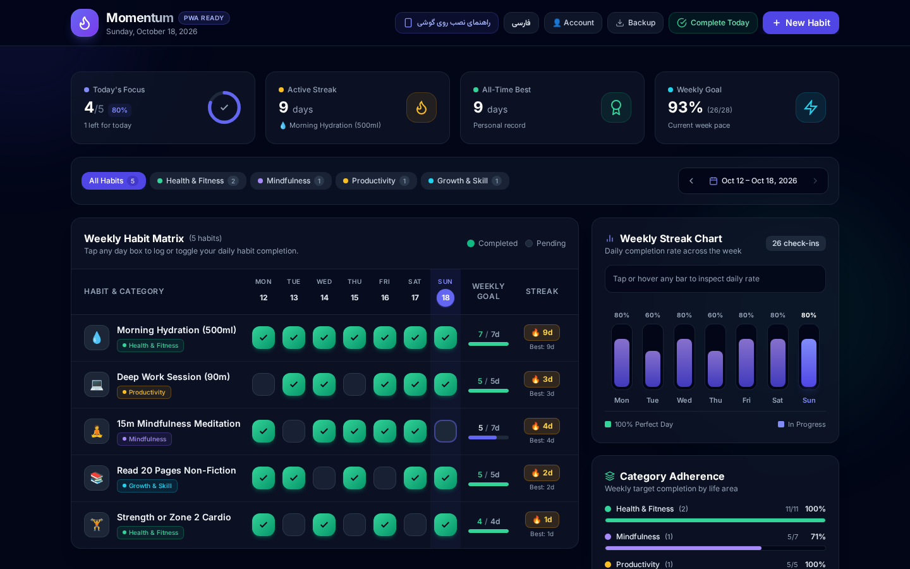
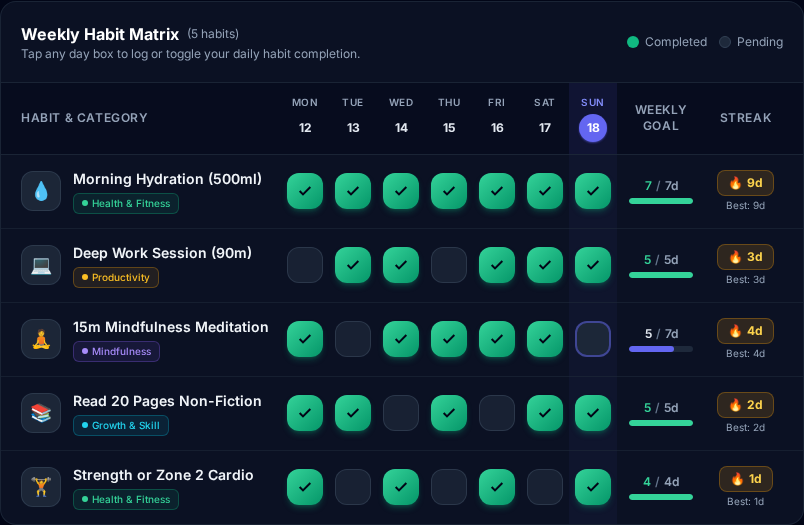
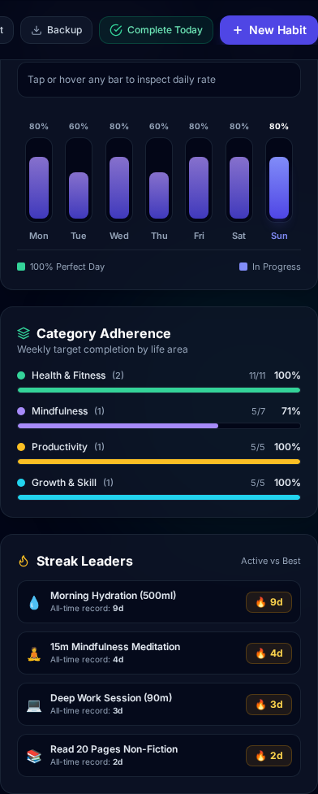
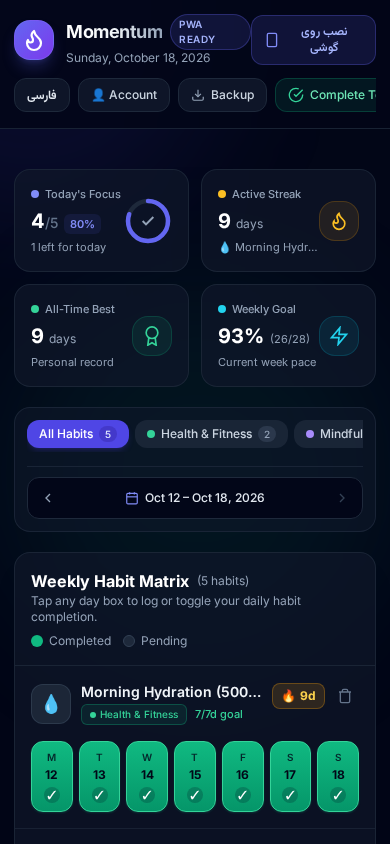

<div align="center">

# Momentum — Habit Studio

<p align="center">
  <strong>A minimal, interactive daily habit tracker and weekly streak studio.</strong>
</p>

<p align="center">
  <a href="https://voidcriterion-cmd.github.io/habits/"><strong>Explore Live Demo »</strong></a>
</p>

[](https://github.com/voidcriterion-cmd/habits)
[](https://github.com/voidcriterion-cmd/habits/commits/main)
[](https://github.com/voidcriterion-cmd/habits/issues)
[](https://developer.mozilla.org/en-US/docs/Web/JavaScript)
[](https://voidcriterion-cmd.github.io/habits/)

<br />



</div>

<br />

---

## 🎯 About Momentum

**Momentum** is a privacy-first, static web application designed to help you build consistency, track daily progress, and monitor long-term streak habits. Built as a zero-backend Single-Page Application (SPA), all data remains strictly under your control inside your browser's local storage with optional end-to-end encrypted cloud backups.

### Key Highlights

- ⚡ **Zero Setup:** Runs directly in any modern web browser without server installations or database setup.
- 🔒 **Privacy First:** Your data never leaves your device unless you choose to create an encrypted backup.
- 📱 **PWA Support:** Installable on iOS and Android devices as a native-feeling full-screen progressive web app with offline capabilities.
- 🌐 **Bilingual (EN / FA):** Seamless English and Persian (فارسی) language switching with dynamic RTL support.

---

## 🔥 Key Features

- **Daily Habit Matrix:** Log daily check-ins across an interactive 7-day weekly grid.
- **Weekly Goals & Target Rates:** Set individual target frequencies (e.g., 5 days/week) with capped progress analytics.
- **Active & All-Time Streaks:** Automatically tracks consecutive check-in days and highlights personal records.
- **Interactive Visual Analytics:** Real-time completion charts, inspectable daily bars, category breakdown progress, and streak leaderboards.
- **Encrypted Google Drive Backups:** Client-side `AES-256-GCM` encryption paired with `PBKDF2-SHA-256` key derivation for secure cloud backups directly into your private Google Drive `appDataFolder`.
- **Local JSON Export & Import:** Download unencrypted `.json` backup snapshots anytime or restore previously saved data files.

---

## 📸 Screenshots Gallery

<div align="center">

| Weekly Habit Matrix | Weekly Analytics & Streaks |
| :---: | :---: |
|  |  |

<br />

| Mobile Touch View |
| :---: |
|  |

</div>

---

## 🚀 Quick Start & Local Run

Because Momentum is built as a static application, you don't need `npm install` or complex build toolchains.

### Option 1: Open Live Web App
Visit **[voidcriterion-cmd.github.io/habits](https://voidcriterion-cmd.github.io/habits/)** in any browser.

### Option 2: Run Locally
```bash
# Clone the repository
git clone https://github.com/voidcriterion-cmd/habits.git
cd habits

# Serve locally using Python's built-in HTTP server
python3 -m http.server 8000
```
Open **`http://localhost:8000`** in your web browser.

---

## 💡 How to Use Momentum

1. **Create a Habit:** Click **+ New Habit** in the top bar. Pick an icon, select a category (*Health, Mindfulness, Productivity, Growth*), and choose your weekly target (1–7 days/week).
2. **Log Check-Ins:** Click or tap any day box on the matrix to mark habits complete.
3. **Track Analytics:** View your daily completion percentages on the Weekly Streak Chart, monitor category adherence rates, and see active streaks.
4. **Backup Your Data:**
   - **Local File:** Click **Backup** > **Download** to save a JSON snapshot to your device.
   - **Encrypted Google Drive:** Click **Account** > **Sign in with Google**, choose a backup passphrase, and click **Connect & backup**.

---

## 🔒 Security & Data Encryption

Momentum treats privacy and data integrity with top priority:

- **Local Storage:** Habit data is stored in browser `localStorage`.
- **Client-Side Encryption:** When backing up to Google Drive, your data is encrypted directly in your browser before upload using:
  - **Algorithm:** `AES-256-GCM` with authenticated additional data (`AAD`).
  - **Key Derivation:** `PBKDF2` with `SHA-256` running 600,000 iterations.
  - **Salt & IV:** Unique 16-byte cryptographically secure random salt and 12-byte IV per backup payload.
- **Zero Server Exposure:** Google Drive backups are stored in a hidden `appDataFolder` accessible only by your authorization token.

---

## 🛠️ Tech Stack

- **Frontend:** HTML5, Modern Vanilla ES6+ JavaScript, Tailwind CSS (via CDN)
- **Typography:** Inter & Vazirmatn Fonts
- **Storage:** Browser `localStorage`, Web Crypto API (`crypto.subtle`)
- **PWA & Deployment:** Service Worker (`sw.js`), `manifest.webmanifest`, GitHub Pages

---

## 📁 Repository Structure

```
habits/
├── index.html              # Main application SPA (UI, state & business logic)
├── manifest.webmanifest    # Web Application Manifest for PWA installation
├── sw.js                   # Service worker for offline caching
├── assets/
│   └── screenshots/        # High-resolution application screenshots
├── scripts/
│   └── capture_screenshots.py # Playwright screenshot capture script
└── README.md               # Project documentation
```

---

<div align="center">

Designed and engineered with care for personal consistency and growth.

</div>
